# Pratinjau semua mesin

Dibuat otomatis oleh `npm run pratinjau` (jangan diedit manual). Buka `index.html` di browser, atau lihat foto di bawah langsung di GitHub.

| Model | Sumber | Desktop | HP |
|---|---|---|---|
| [Alfa Laval MAB 206S-24](alfa-laval-mab206s.html) | main (2026-11-20) | 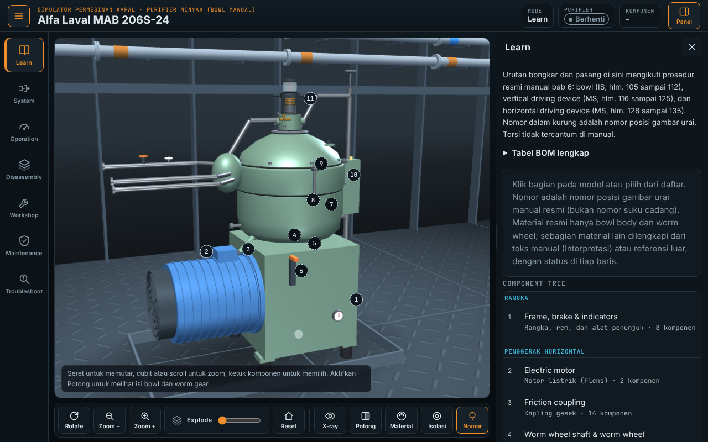 | 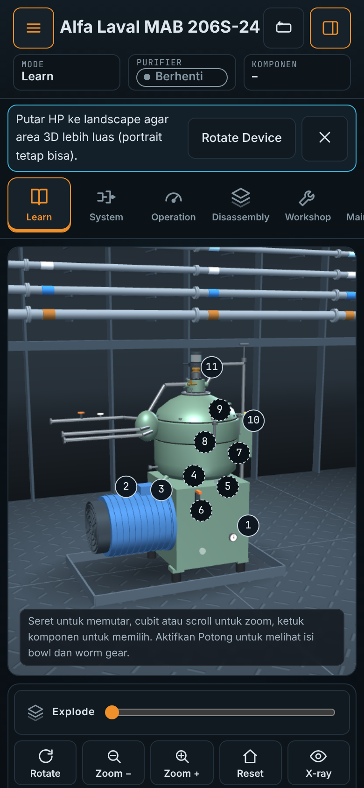 |
| [DESMI NSLH](desmi-nslh.html) | main (2026-11-20) | 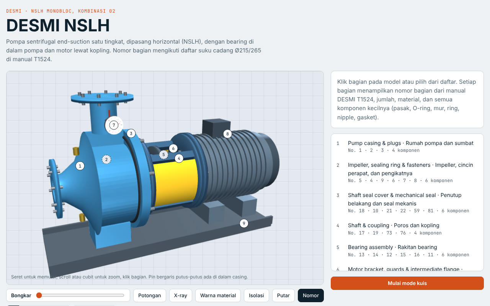 | 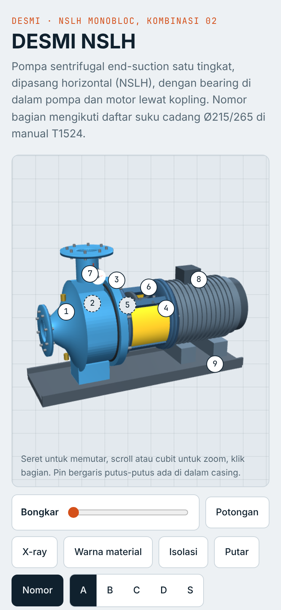 |
| [Mitsubishi SelfJector SJ-H](mitsubishi-sjh.html) | main (2026-11-20) | 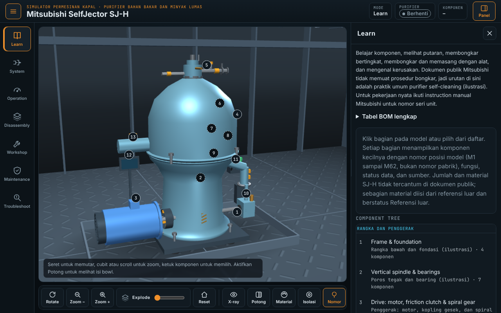 | 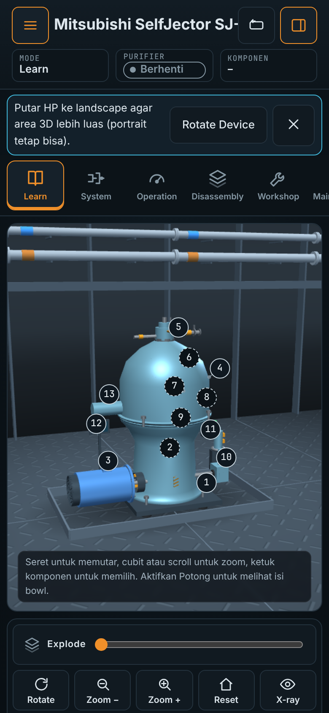 |
| [Shinko GJ 80-25](shinko-gj.html) | main (2026-11-20) | 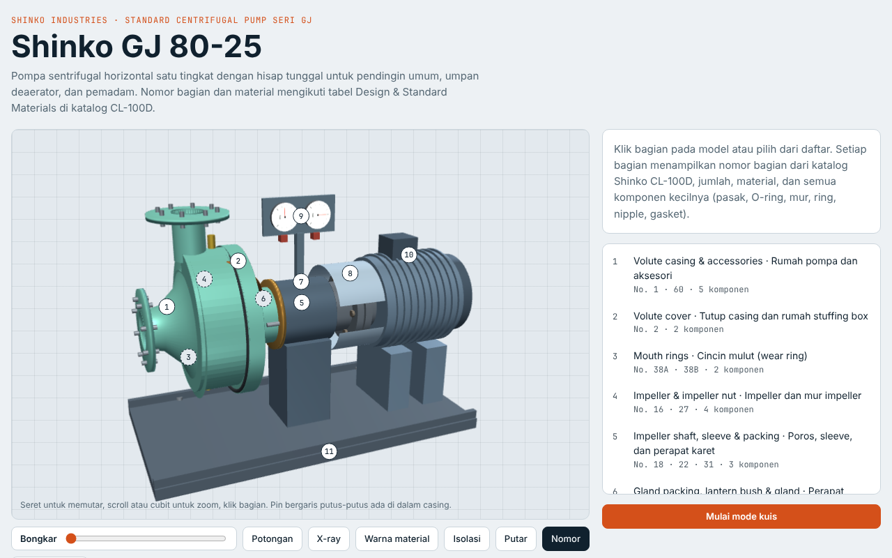 | 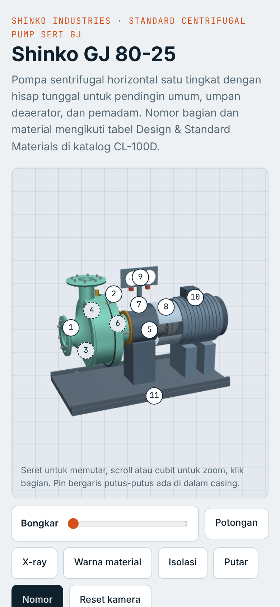 |
| [Shinko GJ 80-25](shinko-gj-sim.html) | main (2026-11-20) | 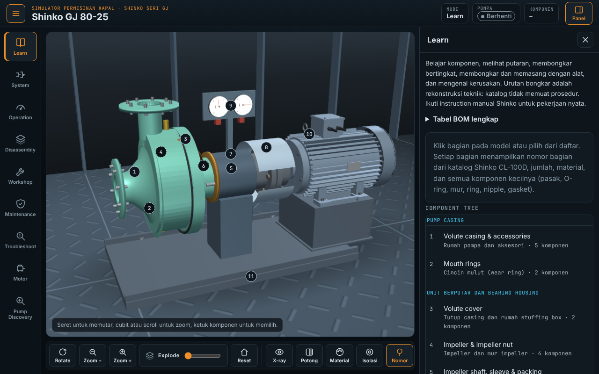 | 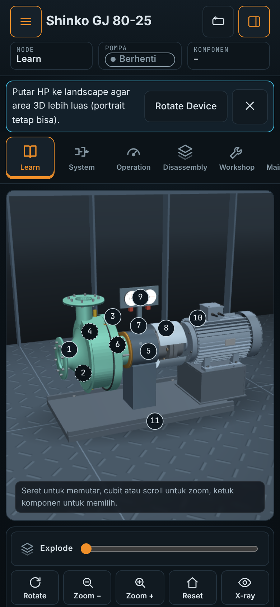 |
| [Taiko HD-300B](taiko-hd300b.html) | main (2026-11-20) | 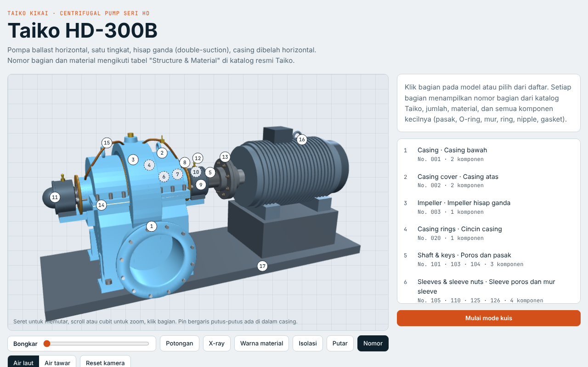 | 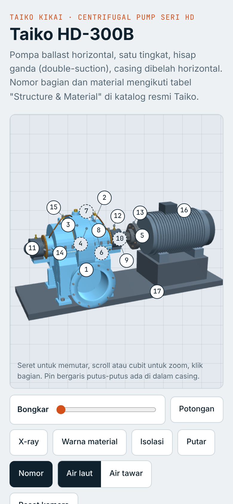 |
| [MAN L23/30H Mk3](man-l2330h.html) | claude/aux-engine-generator (2026-11-19) | 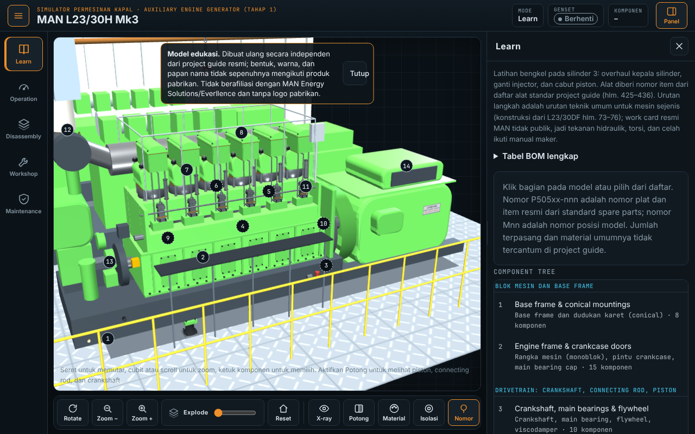 | 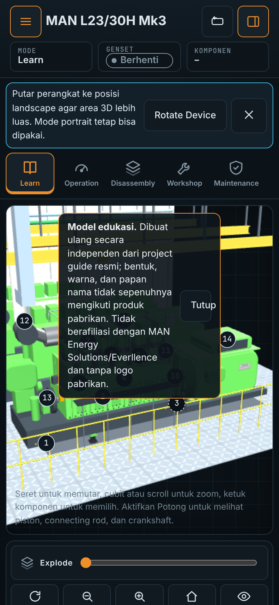 |
| [Tanabe H-74](tanabe-h74.html) | claude/air-compressor (2026-11-19) | 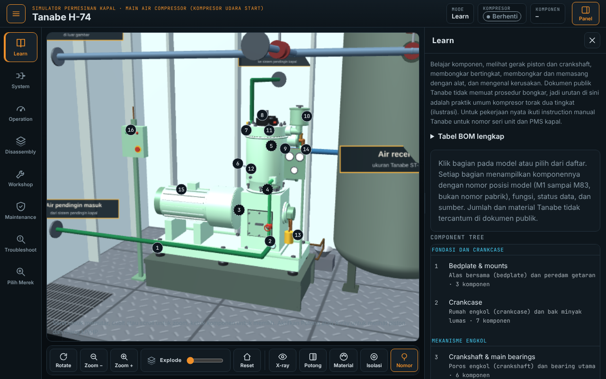 | 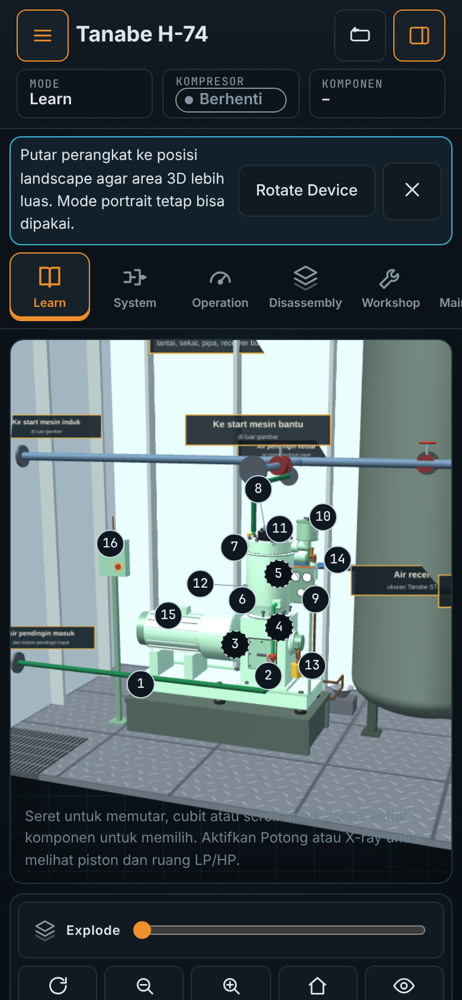 |
